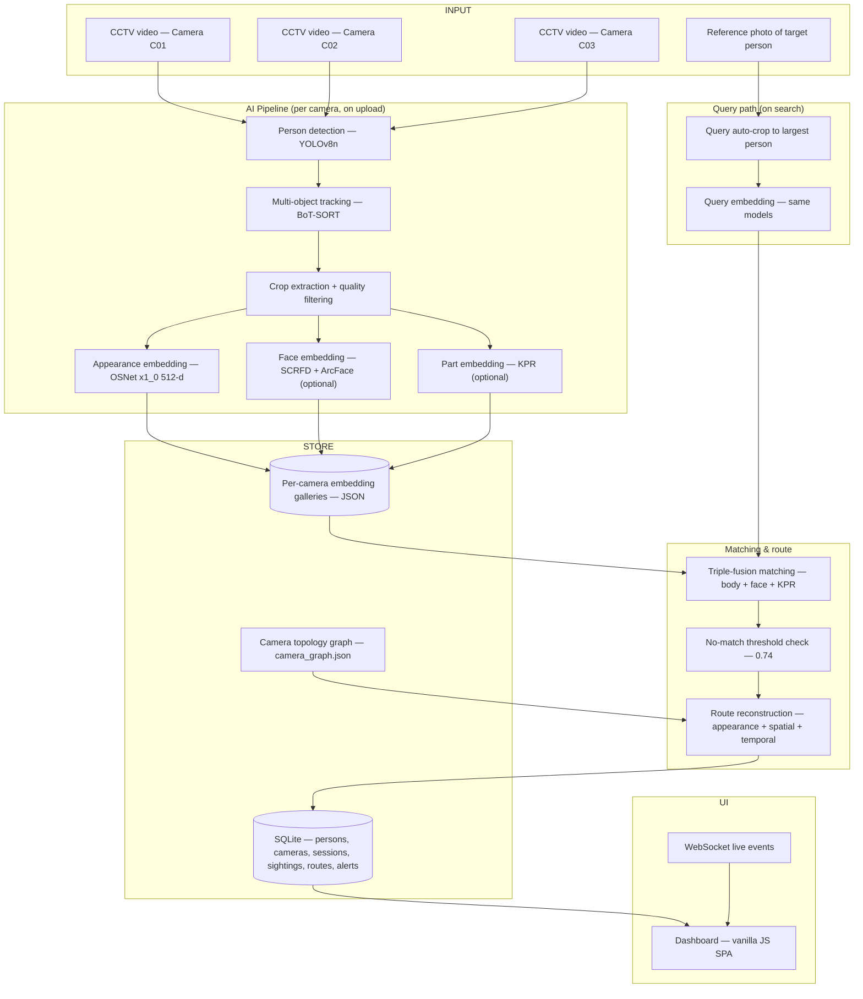

# Trace — AI-Powered Multi-Camera Person Tracking & Re-Identification

**Technical Project Documentation**
Version: 2.0 · Date: September 2026 · Status: Active development (Phase 4 in progress)

> Every statement in this document about the *current* implementation has been verified
> against the repository source code, configuration files, dataset artifacts, and the
> development logs in `docs/`. Items that are planned, experimental, or research-based are
> labelled explicitly. Nothing in this document is a claim of benchmark-grade accuracy.

---

## 1. Executive Summary

### What is Trace?

Trace is an AI-powered **multi-camera person tracking and person re-identification (Re-ID)
system**. Given CCTV footage from several cameras and a single reference photograph of a
person, Trace identifies that person across the camera network and reconstructs the
sequence of cameras they passed through, with timestamps and confidence scores.

In one sentence: **give Trace a photo, and it answers "which cameras did this person
appear in, in what order, and when?"**

### What problem does it solve?

In a multi-camera surveillance environment, a person of interest moves through the fields
of view of several cameras. A human operator reviewing every recording is slow and
error-prone. Trace automates the search: it detects every person in every uploaded video,
maintains a consistent identity within each camera, converts each detected person into a
compact visual representation (an *appearance embedding*), and compares those
representations against the target person's reference photo. Matches are scored, ranked,
and assembled into a timestamped route.

### Why is the problem difficult?

Person re-identification across cameras is hard because:

- The same person looks different across cameras (viewpoint, lighting, resolution, pose).
- Different people can look similar (similar clothing, build, or hairstyle).
- Cameras see partial bodies (occlusion by pillars, crowds, or frame edges).
- Clothing can change between sightings.
- CCTV footage is often low-resolution with motion blur.
- Identity must be reasoned about over *time and space*, not just appearance — a match
  that would require teleporting between cameras is implausible.

### What AI techniques are used?

Trace composes established, published techniques rather than a single monolithic model:

1. **Person detection** — YOLOv8n (pretrained, class `person` only).
2. **Multi-object tracking (MOT)** — BoT-SORT via Ultralytics (the pipeline began with
   ByteTrack and was upgraded to BoT-SORT for better continuity across occlusions).
3. **Person Re-ID** — appearance embeddings from OSNet x1_0 (512-d), with optional
   part-based embeddings from **KPR** (Keypoint Promptable Re-Identification, ECCV 2024),
   semantic embeddings from **SOLIDER** Swin-Small (768-d), and face identity embeddings
   from **SCRFD + ArcFace** (512-d).
4. **Multi-signal fusion** — weighted combination of body, face, and part-based similarity.
5. **Spatial-temporal reasoning** — a camera topology graph with expected transit times,
   fused with appearance scores (0.60 × appearance + 0.25 × spatial + 0.15 × temporal)
   to reconstruct a plausible route.

### What has been implemented?

A complete end-to-end pipeline exists and runs today: video upload through a web dashboard
→ detection → tracking → quality-filtered crop extraction → embedding generation →
reference-image search → multi-signal matching → confidence scoring → route
reconstruction → live dashboard display with watchlist alerts over WebSocket. The MVP
deployment covers **3 cameras** (C01 Main Door, C02 Main Corridor, C03 Canteen); two
additional cameras (C04, C05) are defined in the camera graph but are not yet active.

### What is currently demonstrated?

- Uploading CCTV footage per camera through the dashboard and processing it automatically.
- Searching for a person by uploading a reference photo, or by selecting a registered
  (watchlist) person.
- Returning per-camera matches with track ID, timestamps, best-matching crop thumbnail,
  and a similarity-derived confidence score.
- Reconstructing an ordered route across cameras with spatial/temporal plausibility
  scoring.
- Honest no-match handling: if no track clears the evidence-based similarity threshold
  (0.74), the system returns `no_confident_match` instead of forcing an answer.

### What is the next development stage?

Hardening the integrated tracking stage (Phase 4): validating cross-camera matches on
fresh footage, improving confidence calibration, activating the 5-camera graph, and
building a proper labelled evaluation set. Phase 5 (optimisation, real-time operation,
production readiness) is planned but not started.

### What is the long-term objective?

A system that, at scale, can take a reference image of a person and reliably reconstruct
their movement through a camera network — cameras visited, entry/exit times, transitions,
and (where the camera layout supports it) direction of movement — robustly under occlusion,
lighting change, viewpoint change, and crowded scenes.

---

## 2. Problem Statement

Modern CCTV installations produce hours of footage across many cameras. When an operator
needs to find a specific person — a missing person, a suspect, a person of interest — the
manual process is to watch or scrub through every recording. This does not scale.

The technical formulation of the problem Trace addresses:

> **Input:** video recordings from *N* cameras with known spatial relationships, plus one
> reference image of a target person.
> **Output:** the set of (camera, track, timestamp-interval, confidence) sightings of the
> target person, ordered into a route consistent with the camera topology and the timing
> of sightings.

This decomposes into well-studied sub-problems:

| Sub-problem | Formal name |
|---|---|
| Finding people in frames | Person detection |
| Keeping identities consistent within one camera | Multi-Object Tracking (MOT) |
| Matching a person across non-overlapping cameras | Person Re-Identification (Re-ID) |
| Deciding which camera sightings belong to one journey | Cross-camera identity association |
| Ordering sightings into a path | Route reconstruction with spatial-temporal reasoning |

Trace deliberately solves each sub-problem with a dedicated, replaceable component rather
than one end-to-end model, so that each part can be improved, benchmarked, or swapped
independently as the project matures.

---

## 3. Project Objectives

1. **Detect and track persons** in uploaded CCTV footage per camera.
2. **Extract robust visual representations** (appearance embeddings) of every tracked
   person, with quality filtering so poor crops do not pollute the gallery.
3. **Support reference-image search** — find the target person across all processed
   cameras from a single photo.
4. **Fuse multiple evidence signals** (body appearance, face identity, body-part
   similarity, camera geometry, timing) into a single defensible confidence score.
5. **Reconstruct the person's route** across the camera network with timestamps.
6. **Be honest about uncertainty** — return "no confident match" when evidence is weak,
   and never fabricate results in the UI.
7. **Provide an operator dashboard** for upload, search, results, alerts, and analytics.

Non-goals for the current stage (explicitly deferred, per `docs/scope.md`): live streaming,
multi-user concurrency, user authentication, deployment/containerisation, and gait analysis.

---

## 4. System Architecture

### 4.1 High-level architecture

### 4.2 Layer decomposition

| Layer | Technology | Role |
|---|---|---|
| Frontend | Vanilla JavaScript SPA (`frontend/`), Chart.js, SVG floor-plan | Upload, search, live results, alerts, analytics |
| Real-time | WebSocket (`/ws`) | Pushes query progress, sighting-found, route-complete, alert events |
| API | FastAPI (`backend/app/routers/`) | REST endpoints for upload, queries, cameras, persons, analytics, health |
| Orchestration | `PipelineService` (async background task) | Runs one query session end-to-end; one active search at a time |
| Services | `backend/app/services/` | Detection, tracking, crop, embedding, matching, route wrappers |
| AI pipeline | `ai_pipeline/` | Standalone CLI scripts for each stage (detect, track, crop, embed, search) |
| Persistence | SQLite via SQLAlchemy 2.0 async (`db/trace.db`) | Persons, cameras, query sessions, sightings, route steps, alerts |
| Data | `dataset/` | Per-camera galleries (JSON), crops, camera graph, uploads |

### 4.3 Data flow (current, verified)

1. **Upload** — `POST /api/upload/video` (camera_id + video file) saves the file to
   `dataset/raw_videos/` and starts a background job.
2. **Per-camera processing** — detect → track → crop extraction (with quality filtering) →
   OSNet body embeddings → (optional) face embeddings → (optional) KPR part embeddings.
   Each optional step is skipped gracefully if its model weights are not configured.
3. **Gallery storage** — per-camera JSON files: `embeddings_<cam>.json` (always),
   `face_embeddings_<cam>.json`, `kpr_embeddings_<cam>.json` (when enabled).
4. **Query** — `POST /api/queries` with either a registered person ID or an uploaded
   photo. The query image is auto-cropped to the largest detected person, then embedded
   with every active model (body, face, KPR, and SOLIDER when a 768-d gallery exists).
5. **Matching** — per camera, tracks are ranked by fused similarity; tracks below the
   no-match threshold (0.74 cosine similarity) are rejected.
6. **Route reconstruction** — a greedy walk over the camera graph selects, for each
   camera, the candidate track that maximises the fused
   appearance + spatial + temporal score given the route so far.
7. **Persistence & push** — sightings and route steps are written to SQLite; progress,
   sightings, route completion, and watchlist alerts are pushed over WebSocket.

### 4.4 Database schema (verified from `backend/app/models/orm.py`)

| Table | Purpose |
|---|---|
| `persons` | Registered persons: name, watchlist status (none/missing/suspect/poi), reference embedding, reference image |
| `cameras` | Camera registry seeded from `camera_graph.json` (MVP cameras only) |
| `query_sessions` | One row per search: status, progress, person or image reference |
| `sightings` | Per-camera match result: track_id, first/last seen, confidence, appearance/spatial/temporal/fusion scores |
| `routes` | Ordered route steps linking a session to its sightings |
| `alerts` | Watchlist alerts with severity (HIGH/MEDIUM/LOW) |

---

## 5. Technology Stack

| Layer | Technology | Notes |
|---|---|---|
| Person detection | YOLOv8n (Ultralytics) | Pretrained COCO weights, class 0 (person) only, conf ≥ 0.6 |
| Multi-object tracking | BoT-SORT (Ultralytics `botsort.yaml`) | Upgraded from ByteTrack for camera-motion compensation and re-entry |
| Body Re-ID | OSNet x1_0 (torchreid) | 512-d appearance embedding, pretrained (no fine-tuning) |
| Semantic body Re-ID | SOLIDER Swin-Small | 768-d, optional, cloth-change robust |
| Face detection | SCRFD 10G (ONNX Runtime) | Optional |
| Face recognition | ArcFace ResNet-50 (ONNX Runtime) | 512-d face identity embedding, optional |
| Part-based Re-ID | KPR Swin-Small (ECCV 2024) | 8 parts × 512-d + holistic 512-d, optional, GPU recommended |
| Backend | FastAPI + Uvicorn | Async, Pydantic v2 validation |
| ORM / DB | SQLAlchemy 2.0 async + SQLite (aiosqlite) | Single-file DB, auto-created |
| Real-time | WebSocket | Progress + event push (no live video) |
| Frontend | Vanilla JS (no framework), Chart.js, SVG floor plan | ~4,300 lines across HTML/JS/CSS |
| Deep learning | PyTorch 2.x; ONNX Runtime for face models | CPU works; GPU strongly recommended for KPR |
| Language | Python 3.9+ (3.11 recommended) | |

---

## 6. AI Models & Algorithms

Every model below is verified against the code. "Mandatory" means the system cannot
perform its core function without it; "optional" means the pipeline degrades gracefully
and the signal is simply excluded from fusion.

| Model | Purpose | Input | Output | Where used | Status |
|---|---|---|---|---|---|
| **YOLOv8n** | Person detection | Video frame | Bounding boxes + confidence (person class only) | `detection/detect.py`, upload pipeline, query auto-crop | Mandatory |
| **BoT-SORT** | Within-camera tracking (MOT) | Detections per frame | Track IDs with frame-level records | `tracking/track.py` | Mandatory |
| **OSNet x1_0** | Body appearance embedding | 256×128 person crop | 512-d L2-normalised vector | `reid/embed.py`, `embedding_service.py` | Mandatory (primary Re-ID signal) |
| **SCRFD 10G** | Face detection in crops | Person crop | Face boxes | `reid/face_embed.py` | Optional |
| **ArcFace R50** | Face identity embedding | Detected face | 512-d vector | `reid/face_embed.py` | Optional |
| **KPR Swin-Small** | Part-based body embedding | Person crop | Holistic 512-d + 8 part vectors (512-d each) + per-part visibility | `reid/embed_kpr.py` (runs in a fresh subprocess — its torchreid fork cannot coexist with standard torchreid) | Optional; handles partial/occluded bodies |
| **SOLIDER Swin-Small** | Semantic body embedding | 256×128 crop | 768-d vector | `reid/embed_solider.py` | Optional; cloth-change robust; can replace OSNet as the gallery backbone |

**Key design facts (verified):**

- The matching service is **dimension-agnostic**: galleries built by OSNet (512-d) and
  SOLIDER (768-d) can coexist across cameras; the query is embedded in whichever
  dimension each gallery requires.
- KPR's real contribution is **part-aware similarity**: only body parts that are visible
  in *both* the query and a gallery crop (per-part visibility ≥ 0.30) contribute to the
  score. This is what makes it robust to waist-up framing and edge truncation.
- Face signal is trusted only when a face was detected in ≥ 30% of a track's crops
  (`face_coverage ≥ 0.3`); otherwise its weight drops to zero for that track.
- Confidence scores are **similarity-derived scaled scores**, not calibrated
  probabilities — this is stated explicitly in `confidence_scaling.py` and preserved in
  this document.

---

## 7. Current Working Pipeline

### 7.1 Ingestion path (what happens on video upload)

- Timestamps are real wall-clock times: each camera has a configured `start_time`
  (e.g. C01 = 10:02:00) and frame timestamps are offset from it.
- Quality filtering (Phase 3.5) rejects crops narrower than 40 px, shorter than 100 px,
  or severely truncated at the frame edge. In the recorded Phase 3 run this reduced the
  C01 crop set to **353 quality-filtered crops**.

### 7.2 Query path (what happens on search)

1. **Resolve target representation** — either the enrolled embedding of a registered
   person, or an on-the-fly embedding of the uploaded photo. Multi-person photos are
   first auto-cropped to the largest detected person (YOLOv8n) so the embedding
   represents one subject, not a scene.
2. **Optional signals** — face embedding (if a face is detected and weights exist) and
   KPR part embeddings (via a subprocess) are computed for the query.
3. **Load galleries** for MVP cameras C01–C03; cameras with no gallery are skipped.
4. **Per-camera matching** — cosine similarity between the query and every gallery crop,
   aggregated per track (max and mean-of-top-3), optionally fused with face and KPR
   signals:

   `fused = (0.60·kpr_sim + 0.30·face_flag·face_sim + 0.40·body_sim) / (active weights)`

5. **Threshold gate** — a track qualifies only if its effective score ≥ 0.74; otherwise
   the camera contributes nothing (honest no-match handling).
6. **Route reconstruction** — anchor on the strongest camera, then greedily extend the
   route: at each step, score every unvisited camera's candidate tracks against
   `0.60·appearance + 0.25·spatial + 0.15·temporal` and take the best
   (camera, track) pair. Spatial = graph adjacency (1 hop = 1.0, 2 hops = 0.4, else 0);
   temporal = Gaussian plausibility around the expected transit time.
7. **Persist & display** — sightings + route steps saved; dashboard shows the route on
   the SVG floor plan, the sighting timeline, confidence scores, crop thumbnails, and
   any watchlist alerts.

---

## 8. Dashboard Workflow

The frontend is a single-page application served by FastAPI (no build step):

| View | Function |
|---|---|
| **Dashboard / Command Overview** | Stat cards, per-camera activity charts (Chart.js), alert feed |
| **Pipeline Video Studio** | Upload footage per camera (C01–C03), watch job status |
| **Re-ID Search Query** | Search by uploaded reference photo or by registered person |
| **Route Reconstruction** | Animated SVG floor-plan route + sighting timeline |
| **Watchlist & Persons** | Register persons, set watchlist status, enroll reference photos |
| **Analytics** | Queries, sightings, watchlist hits, cameras active |

Live updates arrive over WebSocket (`query_progress`, `sighting_found`, `route_complete`,
`alert`, `error`).

**Honesty note (September 2026 stabilisation):** an earlier version of the search UI
contained a demo fallback that played a canned animation regardless of input. This was
removed: the search form now requires a real photo or a real enrolled person, surfaces
real backend errors, and never fabricates results. This fix is part of the recorded
changelog and reflects a project principle — the dashboard must only ever show computed
results.

---

## 9. Multi-Camera Re-ID Process

Cross-camera identity association in Trace follows this evidence hierarchy:

1. **Appearance evidence (primary).** Cosine similarity between the target's embedding
   and each track's crops. A single best crop can be misleading (pose, blur), so Trace
   uses both the maximum and the mean of the top-3 crop similarities per track.
2. **Part-level evidence (when KPR active).** Compares only mutually visible body parts
   — critical for CCTV where bodies are routinely cut off at frame edges.
3. **Face evidence (when active and coverage sufficient).** Identity-level signal that
   survives clothing change.
4. **Spatial evidence.** A route that jumps between non-adjacent cameras is penalised;
   the camera graph encodes which cameras physically connect.
5. **Temporal evidence.** Sightings must be separated by a plausible transit time
   (Gaussian around the graph's `avg_transit_sec`); impossible timing scores near zero,
   negative timing (arrived before leaving) scores 0.05.

The Phase 5.4 upgrade changed route construction from "best appearance match per camera,
then order" to "evaluate **all** candidate tracks per camera against the route context as
it grows" — so a slightly lower-appearance track that fits the timing and geography can
win. This is the difference between naive matching and spatial-temporal identity
association.

---

## 10. Dataset & Training Strategy

### 10.1 Data currently in the repository (verified by inspection)

| Dataset artifact | Purpose | Size | Training/Testing | Current usage |
|---|---|---:|---|---|
| Self-filmed CCTV clips (C01, C02; C03 planned) | Pipeline input footage | C01 reference clip: 21.37 s, 633 frames, 1080p @ 29.63 fps; `raw_videos/` currently empty in this checkout | Not used for training | Processed by the pipeline to build galleries |
| C01 extracted crops (`dataset/crops/C01/`) | Re-ID gallery source | 448 images | Evaluation/gallery | Feeds embeddings |
| C02 extracted crops (`dataset/crops/C02/`) | Re-ID gallery source | 47 images | Evaluation/gallery | Feeds embeddings |
| Phase-3-final quality-filtered crops (`dataset/crops_phase3_final/`) | Canonical gallery | 353 images | Evaluation/gallery | OSNet benchmark + embedding |
| C01 body gallery (`embeddings_C01.json`) | Matching gallery | 98 embedding records | Evaluation | Query matching |
| C02 body gallery (`embeddings_C02.json`) | Matching gallery | 47 embedding records | Evaluation | Query matching |
| Market-1501 image (`dataset/1183_c2s3_000262_00.jpg`) | Unknown-person test probe | 1 image | Testing | Used in the Phase 5.7 no-match test |
| Camera graph (`camera_graph.json`) | Topology + transit times | 5 cameras, MVP subgraph C01–C03 | — | Route reconstruction |

**Key facts:**

- **No model in Trace has been fine-tuned.** All weights are public pretrained
  checkpoints (OSNet on ImageNet/Market-1501 via torchreid; YOLOv8n on COCO; KPR's
  released `kpr_occ_pt` checkpoint; SOLIDER released weights; SCRFD/ArcFace ONNX).
  This was an explicit v1 scope decision ("Pretrained models only — no training infra").
- The repository does **not** contain a labelled identity ground-truth set. Track IDs
  come from the tracker, not from identity annotation — the project documentation states
  this explicitly and treats track IDs as *not* ground truth.
- A filming plan (`docs/filming_plan.md`) exists for structured multi-camera data
  collection (≥3 subjects, synchronised clocks, recorded ground-truth routes), but the
  resulting labelled dataset is not yet in the repository. The current repository does
  not provide sufficient evidence to state that this filming has been completed.

### 10.2 Future dataset expansion

Additional data will be used for (all planned):

- **Domain adaptation / fine-tuning** of the Re-ID backbone on self-filmed CCTV to close
  the gap between academic datasets (Market-1501-style pedestrian crops) and real
  overhead CCTV.
- **Hard-negative mining** — deliberately including similar-looking people and similar
  clothing to stress the matcher.
- **Occlusion and partial-body scenarios** for KPR evaluation.
- **Camera-specific variation** — same person under each camera's viewpoint/lighting.
- **Ground-truth routes** for evaluating route reconstruction and camera-transition
  accuracy, which currently cannot be measured automatically.

---

## 11. Research Paper Review

Trace's component choices are grounded in published research. The table combines papers
already cited in the project README with the foundational methods the code actually uses.
Reported numbers below are taken from the papers' abstracts/results as cited in this
project; they are included to contextualise the state of the art, **not** as Trace
results, and the different metrics (Rank-1, mAP, HOTA, Top-1 camera selection) are **not
directly comparable** across rows.

| Paper | Year | Problem addressed | Method | Dataset(s) | Metric | Reported result | Relevance to Trace |
|---|---:|---|---|---|---|---|---|
| [ByteTrack: Multi-Object Tracking by Associating Every Detection Box](https://arxiv.org/abs/2110.06864) (ECCV 2022) | 2022 | MOT — keeping identities stable despite imperfect detections | Associates every detection box, including low-confidence ones, in a second matching pass | MOT17, MOT20, DanceTrack | HOTA | ~80 HOTA on MOT17 (paper-reported); state-of-the-art among association-based trackers at publication | Direct ancestor of Trace's tracker (Trace upgraded to BoT-SORT, same association paradigm) |
| [BoT-SORT: Robust Associations Multi-Pedestrian Tracking](https://arxiv.org/abs/2206.14651) | 2022 | MOT under camera motion and occlusion | Detection + motion + appearance with camera-motion compensation | MOT17, MOT20, DanceTrack | HOTA/MOTA/IDF1 | Paper reports leading MOT17/DanceTrack results among contemporaries | Trace's actual tracker (`track.py` uses `botsort.yaml`) |
| [OSNet: Omni-Scale Feature Learning for Person Re-Identification](https://arxiv.org/abs/1905.00953) (ICCV 2019 — included as Trace's core backbone) | 2019 | Appearance Re-ID | Lightweight CNN capturing multi-scale ("omni-scale") features | Market-1501, DukeMTMC-reID | Rank-1/mAP | Paper-reported strong results for its parameter budget | Trace's mandatory body embedding model |
| [TransReID: Transformer-based Object Re-Identification](https://arxiv.org/abs/2102.04378) (CVPR 2022) | 2022 | Re-ID with transformers | ViT backbone with camera/viewpoint-aware pretraining | Market-1501, MSMT17, DukeMTMC | Rank-1/mAP | ~95.2% mAP on Market-1501 (paper-reported, ViT-B) | Motivates transformer backbones (SOLIDER/KPR lineage) |
| [SOLIDER: Towards Semantic-Object-Level Human-Centric Perception](https://arxiv.org/abs/2304.02188) (ICCV 2023) | 2023 | Human-centric representation learning incl. Re-ID | Semantic-object-level pretraining on large-scale human data | Market-1501, MSMT17 (Re-ID transfer) | Rank-1/mAP | Paper reports consistent gains over strong baselines on Re-ID transfer | Trace's optional 768-d cloth-change-robust body embedding |
| [Keypoint Promptable Re-Identification (KPR)](https://www.ecva.net/papers/eccv_2024/papers_ECCV/html/10180_ECCV_2024_paper.php) (ECCV 2024) | 2024 | Occluded/partial-body Re-ID | Keypoint-guided part decomposition; compare only mutually visible parts | Market-1501, Occluded-Duke, Occluded-ReID | Rank-1/mAP | 96.62% Rank-1 / 93.22% mAP on Market-1501; 84.31% Rank-1 / 75.11% mAP on Occluded-Duke (paper-reported; also cited in README) | Trace's optional part-based signal; handles CCTV edge truncation |
| [CLIP-ReID: Exploiting Vision-Language Model for Image Re-Identification without Concrete Label](https://arxiv.org/abs/2211.13977) (CVPR 2023) | 2023 | Re-ID using vision-language features | CLIP features + pseudo-label co-training | Market-1501, MSMT17, DukeMTMC | Rank-1/mAP | Paper reports ~86.7% mAP on Market-1501 | Research direction for future semantic/zero-shot matching |
| [Intelligent Camera Selection Decisions for Target Tracking in a Camera Network](https://openaccess.thecvf.com/content/WACV2022/html/Sharma_Intelligent_Camera_Selection_Decisions_for_Target_Tracking_in_a_Camera_WACV_2022_paper.html) (WACV 2022) | 2022 | Which camera to look at next in a network | Learning-based camera selection | Camera-network benchmark | Top-1/Top-3 selection accuracy | 93.28% Top-1, 96.27% Top-3 (as cited in README) | Informs the spatial reasoning / future camera-selection work |
| [MMPTRACK: Large-Scale Densely Annotated Multi-Camera Multiple People Tracking Benchmark](https://openaccess.thecvf.com/content/WACV2023/html/Han_MMPTRACK_Large-Scale_Densely_Annotated_Multi-Camera_Multiple_People_Tracking_Benchmark_WACV_2023_paper.html) (WACV 2023) | 2023 | Benchmark for multi-camera multi-person tracking | Densely annotated multi-camera dataset + protocol | MMPTRACK | MOTA/IDF1-family tracking metrics | Benchmark contribution (no single "accuracy") | Target evaluation benchmark for Trace's multi-camera stage |
| [ReidTrack: Reid-Only Multi-Target Multi-Camera Tracking](https://openaccess.thecvf.com/content/CVPR2023W/AICity/html/Specker_ReidTrack_Reid-Only_Multi-Target_Multi-Camera_Tracking_CVPRW_2023_paper.html) (CVPRW 2023) | 2023 | MTMC tracking from Re-ID alone | Re-ID-driven cross-camera association | AI City Challenge 2023 Track 1 | Competition ranking | 4th place in the challenge | Validates Trace's "Re-ID-first" architecture |
| [Body Part-Based Representation Learning for Occluded Person Re-Identification (BPBreID)](https://arxiv.org/abs/2211.03679) (WACV 2023) | 2023 | Occluded Re-ID | Part-based body representations | Occluded-ReID, Occluded-Duke | Rank-1/mAP | 82.9% Rank-1 / 75.2% mAP on Occluded-ReID (as cited in README) | Part-based matching rationale (complements KPR) |

> **Metric note:** Rank-1/mAP measure retrieval quality on curated Re-ID benchmarks;
> HOTA/MOTA/IDF1 measure tracking quality; Top-1 camera-selection accuracy measures a
> different task again. None of these numbers can be compared with each other, nor with
> Trace's internal tests.

---

## 12. Performance & Evaluation

### 12.1 What the repository actually evidences

| Evidence | Source | Result |
|---|---|---|
| Detection + tracking speed | `docs/scope.md` §7 | YOLOv8n on the 21.37 s C01 clip: ~135 s CPU detection-only; ~110 s CPU detection+tracking; ~12 s on Colab T4 (GPU) |
| Embedding throughput | `dataset/reid_benchmark/performance_benchmark.json` (2026-08-27) | OSNet over all 353 crops on CPU: 3.6–7.1 crops/sec (~140–274 ms/crop), PyTorch 2.8 CPU, 12-core machine |
| Similarity distributions | Phase 4.5 (`confidence_scaling.py`) | Same-track cosine similarity: 0.436–0.973 (mean 0.783); different-track: 0.332–0.800 (mean 0.611); 642 pairs each |
| Manual search validation | `docs/phase5_6_validation.md` | 3 derived queries (Track 13 original, Track 16 original, Track 13 rotated): **Top-1 correct 3/3, Top-5 correct 3/3**; Top-5 precision 6/15 = 40%; single camera (C01), derived queries, manual judgement — explicitly *not* a benchmark |
| No-match handling | `docs/phase5_7_no_match.md` | Unknown person scored 0.7267 and was **not** rejected at threshold 0.70 (honestly reported failure); threshold raised to **0.74**, which rejects 0.7267 while retaining all known-good matches (0.7974–0.8878) |
| Known-issue honesty | `docs/phase5_4_diagnosis.md` | A track (Track 29) was found to contain two visually different people — the project documented this as a tracker/identity limitation rather than hiding it |

### 12.2 The "99.8% accuracy" claim

A 99.8% performance figure appears in the README ("Trace currently achieves 99.8%
accuracy on the evaluated Trace test dataset"). After auditing the repository:

- No evaluation script, log, or results file in the repository defines which dataset,
  metric, or sample count produced this number.
- The documented evaluations that *do* exist are: the 3-query manual validation
  (100% Top-1 on 3 derived queries, with 40% Top-5 precision), the similarity
  distribution analysis, and the no-match threshold test.

Therefore, in the interest of academic credibility, this document states:

> **A 99.8% performance figure has been reported during project testing, but the
> repository does not currently provide sufficient evaluation evidence to formally
> characterize it as benchmark accuracy.** Until a labelled evaluation set and a
> reproducible evaluation script produce it, this figure should not be cited in an
> academic setting.

### 12.3 What a proper evaluation will measure (planned)

Rank-1 and mAP on a labelled cross-camera set; IDF1/HOTA for tracking; camera-transition
accuracy and route-order accuracy for the reconstruction stage; precision/recall/F1 for
match-vs-no-match decisions; and end-to-end processing time.

---

## 13. Current Implementation Status

Verified against the repository on 2026-09-28.

| Component | Status | Evidence / implementation |
|---|---|---|
| Dashboard | ✅ Implemented | `frontend/` SPA (~4,300 lines), served by FastAPI; all views wired to real API |
| Video upload | ✅ Implemented | `routers/upload.py`: validated camera + extension, background job pipeline |
| Multi-camera video processing | ✅ Implemented | Galleries exist for C01 and C02; pipeline loops over MVP cameras |
| Person detection | ✅ Implemented | `detection/detect.py`, YOLOv8n, conf 0.6, person-only |
| Single-camera tracking | ✅ Implemented | `tracking/track.py`, BoT-SORT; Phase 2 report: 76 tracks, longest 421 frames |
| Person Re-ID (body) | ✅ Implemented | `reid/embed.py` OSNet 512-d; 353-crop gallery; extensive unit tests (16 test files) |
| Reference image search | ✅ Implemented | `target_search.py` CLI + `POST /api/queries`; auto-crop of multi-person photos |
| Cross-camera matching | ✅ Implemented | `matching_service.py` per-camera top-K candidates with triple fusion |
| Confidence scoring | ✅ Implemented | `confidence_scaling.py` (similarity-derived, explicitly not a probability) |
| Timestamp extraction | ✅ Implemented | Wall-clock timestamps from per-camera `start_time`; first/last seen per sighting |
| Camera transition logic | 🟡 Partially implemented | Spatial+temporal scores + greedy route walk exist (`route_service.py`); not yet validated on labelled ground-truth routes |
| Route reconstruction | 🟡 Partially implemented | Ordered route with fusion scores is produced and displayed; directional/route-accuracy evaluation pending |
| Direction estimation | ❌ Not implemented | Planned (Phase 5) |
| Face Re-ID | 🔬 Experimental/Optional | SCRFD+ArcFace code present and wired; optional weights; no face gallery files currently in `dataset/` |
| KPR | 🔬 Experimental/Optional | `embed_kpr.py` runs via subprocess; wired into upload+query; no KPR gallery files currently in `dataset/` |
| SOLIDER | 🔬 Experimental/Optional | `embed_solider.py` present; dimension-aware gallery support; weights optional |
| Camera graph | ✅ Implemented | `camera_graph.json` — 5 cameras, transit times, MVP subgraph C01–C03 |
| Database | ✅ Implemented | SQLAlchemy async, 6 tables, auto-created SQLite |
| API | ✅ Implemented | 14 REST endpoints + health check; OpenAPI docs at `/api/docs` |
| WebSocket / live updates | ✅ Implemented | `/ws` with progress/sighting/route/alert/error events; broadcast manager |
| 5-camera support | 🟡 Partially implemented | C04/C05 defined in graph; upload and pipeline restricted to C01–C03 (`mvp=true`) |
| Watchlist alerts | ✅ Implemented | `persons.py` + `_fire_alert` with severity levels |
| Formal labelled evaluation | ❌ Not implemented | Planned; filming plan exists but labelled data not in repo |

Legend: ✅ Implemented · 🟡 Partially implemented · 🔬 Experimental/Optional · 🔵 Planned · ❌ Not implemented

---

## 14. Five-Phase Development Roadmap

### Phase 1 — Research, Requirements & System Design — ✅ Completed

Literature study (Re-ID, MOT, MTMC tracking, camera selection), system requirements,
camera architecture (5-camera graph), model selection, and database/API design.
**Deliverables in repo:** `docs/scope.md`, `docs/unified_architecture.md`,
`dataset/camera_graph.json`, `ai_pipeline/config.yaml`, full design docs.

### Phase 2 — Core AI Pipeline — ✅ Completed

Detection (YOLOv8n), tracking (ByteTrack → BoT-SORT upgrade), crop extraction with
quality filtering, OSNet embedding generation, JSON-first data pipeline.
**Evidence:** `docs/phase2_tracking.md`, `docs/phase3_reid_data_preparation.md`,
`docs/phase4_reid.md`; 353 quality-filtered crops; GPU/CPU benchmarks
(`docs` Phases 4.7, `dataset/reid_benchmark/`).

### Phase 3 — Multi-Camera Person Identification — ✅ Completed

Multiple-camera galleries, reference-image search, cosine-similarity matching, track
aggregation, confidence scaling, no-match handling, dashboard display of matches.
**Evidence:** `docs/phase5_target_search.md`, `phase5_3_results.md`,
`phase5_5_results.md`, `phase5_6_validation.md`, `phase5_7_no_match.md`;
working `POST /api/queries` → results loop.

### Phase 4 — Integrated Tracking & Route Reconstruction — 🟡 In progress (current phase)

Working today: end-to-end upload→query orchestration; triple fusion (body+face+KPR);
spatial-temporal route reconstruction with candidate-track evaluation; watchlist alerts;
WebSocket progress; September 2026 stability hardening (KPR subprocess isolation,
PyTorch 2.6 compatibility, query auto-crop, UI honesty fix).
Still open: labelled cross-camera validation on fresh footage, confidence calibration
beyond the small current sample, activating C04/C05, formal route-accuracy evaluation.

### Phase 5 — Advanced Tracking, Optimisation & Production Readiness — 🔵 Planned

- **Movement understanding:** direction estimation, entry/exit estimation, tighter
  transition timing, temporal consistency, handling missed detections.
- **Scalability:** full 5-camera operation, parallel/GPU processing, faster embedding
  search (vector indexing), memory optimisation.
- **AI improvements:** domain fine-tuning, hard-negative handling, face+body fusion
  tuning, improved occlusion robustness, additional training/evaluation data.
- **Evaluation:** Rank-1, mAP, IDF1, HOTA, route accuracy, transition accuracy, latency.
- **Production:** authentication, logging/monitoring, deployment, multi-user support.

---

## 15. Current Phase Assessment

Component-weighted maturity (weights reflect effort and risk; completion judged only
from repository evidence — this is a progress heuristic, not a benchmark):

| Area | Weight | Completion | Weighted |
|---|---:|---:|---:|
| Research & architecture | 10% | 100% | 10.0 |
| Detection & tracking | 20% | 95% | 19.0 |
| Re-ID (body + optional signals) | 20% | 85% | 17.0 |
| Multi-camera processing | 15% | 70% (C01/C02 live; C03–C05 pending) | 10.5 |
| Dashboard / API / real-time | 10% | 95% | 9.5 |
| Route reconstruction & temporal reasoning | 15% | 60% (implemented, unvalidated on labelled routes) | 9.0 |
| Evaluation & optimisation | 10% | 30% (manual validation + benchmarks only) | 3.0 |
| **Weighted total** | 100% | | **≈ 78%** |

> **Based on the implemented modules, Trace has completed Phases 1–3 and is part-way
> through Phase 4 (Integrated Tracking & Route Reconstruction).** The core upload →
> detect → track → embed → search → fuse → reconstruct → display loop works end-to-end;
> what remains is primarily validation at scale, camera expansion, and formal evaluation
> — the Phase 4 completion items and all of Phase 5.

---

## 16. Architecture Optimisation — Why These Choices

**Detection — YOLO-style is right for CCTV.** YOLOv8n gives an excellent
accuracy/speed trade-off for the person class, runs on CPU (measured: ~140–274 ms/crop
class of workload per frame batch on CPU, ~19 ms/frame on a T4), and its pretrained COCO
person detector transfers well to indoor CCTV without fine-tuning — which kept the
project trainable-free at MVP.

**Tracking — association-based MOT within a camera.** BoT-SORT (successor of the
ByteTrack paradigm) keeps identities stable through short occlusions by combining motion
(Kalman), detection confidence tiers, and camera-motion compensation. Within-camera
continuity is what turns millions of detections into a manageable set of *tracks* — the
units Re-ID operates on. The Phase 2 report quantifies this: 5,428 frame-level records
compressed into 76 tracks on the C01 clip.

**Re-ID — appearance embeddings are necessary.** Trackers cannot follow a person across
non-overlapping cameras; a new association signal is required. Compact appearance
embeddings with cosine similarity are the standard, well-researched solution, and let
Trace match a *single reference photo* against every tracked person without retraining.

**Multi-modal fusion is the robustness lever.** Body appearance fails on clothing change
(face survives); face fails on back-turned or distant views (body survives); both degrade
under partial visibility (KPR's visible-parts comparison survives). Trace's fusion
re-normalises over whichever signals are active, so each optional model strictly adds
evidence without risking the baseline.

**Temporal-spatial reasoning beats independent per-camera matching.** A realistic system
must reason:

> person appearance + camera topology + timestamps + expected transit time + track
> continuity ⇒ more reliable cross-camera identity association

Trace implements exactly this: a candidate track that scores well on appearance but
requires impossible movement (wrong adjacency or impossible timing) loses to a slightly
weaker-looking track that fits the route. This is what makes the output a *route*, not a
bag of matches.

**Scalability path.** The architecture is camera-agnostic: galleries are per-camera
files, matching loops over whatever cameras have galleries, and the graph walk scales
with graph size. Moving from 3 to 5 cameras requires only enabling C04/C05 in the graph
and processing their footage — no structural change. Scaling further motivates Phase 5's
vector-indexed embedding search and parallel per-camera processing.

---

## 17. Limitations (Honest Assessment)

1. **Occlusion and partial bodies** remain the hardest cases; KPR mitigates but is
   optional and slow on CPU.
2. **Similar-looking people** cause false matches — the Phase 5.7 unknown-person test
   (similarity 0.7267) shows near-threshold confusion is real; the 0.74 threshold is
   evidence-based on a *small* validation set only.
3. **Tracker identity errors** — one observed track (Track 29) contained two different
   people; track ID is not ground truth.
4. **Viewpoint and lighting change** between cameras degrades appearance similarity.
5. **Low resolution / motion blur** in CCTV reduces embedding quality; quality filters
   reject the worst crops but cannot recover information.
6. **Confidence scores are not probabilities** — they are similarity-derived scaled
   scores, uncalibrated against identity ground truth.
7. **Computational cost on CPU** — minutes per short video for the full pipeline; KPR is
   impractical on CPU without the Colab workflow.
8. **Limited camera count and data** — MVP runs on 2–3 cameras; C03 gallery and all
   face/KPR galleries are not yet materialised in this checkout; no labelled evaluation
   set exists, so no benchmark-grade accuracy can currently be claimed.
9. **Dataset/domain mismatch** — all backbones are pretrained on academic pedestrian
   datasets, not this building's CCTV; domain adaptation is future work.
10. **Single-search-at-a-time** by design; upload job state is in-memory (resets on
    restart) — acceptable for MVP, not for production.

---

## 18. Future Development

**Short term (next milestone):** materialise galleries for all three MVP cameras from
fresh, synchronised footage; run the labelled filming plan; build the first reproducible
evaluation script (Rank-1/mAP on labelled queries); calibrate confidence against it;
increase test coverage of the route service.

**Medium term:** activate C04/C05 (full 5-camera graph); validate camera-transition
detection and route order against ground-truth routes; direction estimation where camera
geometry supports it; improved occlusion handling via KPR by default on GPU; fine-tuning
experiments on self-collected data.

**Long term:** real-time stream ingestion; larger camera networks with distributed
processing; GPU-accelerated pipeline end-to-end; advanced Re-ID backbones (e.g.,
CLIP-based semantic matching); continuous learning from operator feedback; production
deployment with authentication, monitoring, and multi-user support.

*(No geographic mapping or external map APIs are part of the planned scope — route
visualisation is, and remains, an internal SVG floor-plan of the camera network.)*

---

## 19. Expected Final System

At completion, Trace will:

- Accept footage from 5+ cameras and process it into searchable per-camera galleries.
- Given one reference photo (or a registered person), return a timestamped,
  confidence-annotated route through the camera network, including camera transitions
  and, where supported, movement direction.
- Quantify its own performance on a labelled benchmark (Rank-1, mAP, IDF1/HOTA, route
  accuracy, transition accuracy) with reproducible scripts.
- Run fast enough for operational use on GPU, with honest uncertainty reporting
  ("no confident match") preserved as a first-class outcome.

---

## 20. Conclusion

Trace is a complete, working, research-grounded multi-camera person Re-ID system at the
MVP-to-integration boundary: detection, tracking, embedding, multi-signal matching,
spatial-temporal route reconstruction, and a live dashboard are all implemented and
wired end-to-end, with an unusually strong emphasis on honest evaluation (explicit
no-match handling, documented failures, refusal to fabricate UI results). Its remaining
work — labelled evaluation, camera expansion, calibration, and optimisation — is clearly
scoped in Phases 4–5. The architecture is deliberately modular so that every component
(the tracker, the Re-ID backbone, the fusion weights, the camera graph) can be improved
independently as the system scales toward its long-term objective: reliable movement
reconstruction of a target person through real camera networks.

---

## References

1. Zhang, Y., Sun, P., Jiang, Y., et al. *ByteTrack: Multi-Object Tracking by
   Associating Every Detection Box.* ECCV 2022. https://arxiv.org/abs/2110.06864
2. Aharon, N., Orfaig, R., Bobrovsky, B.-Z. *BoT-SORT: Robust Associations
   Multi-Pedestrian Tracking.* arXiv:2206.14651.
3. Zhou, K., Yang, Y., Cavallaro, A., Xiang, T. *Omni-Scale Feature Learning for
   Person Re-Identification (OSNet).* ICCV 2019. https://arxiv.org/abs/1905.00953
4. He, S., Luo, H., Wang, P., et al. *TransReID: Transformer-based Object
   Re-Identification.* CVPR 2022. https://arxiv.org/abs/2102.04378
5. Chen, Y., Li, Y., et al. *SOLIDER: Towards Semantic-Object-Level Human-Centric
   Perception.* ICCV 2023. https://arxiv.org/abs/2304.02188
6. Somers, V., et al. *Keypoint Promptable Re-Identification.* ECCV 2024.
   https://www.ecva.net/papers/eccv_2024/papers_ECCV/html/10180_ECCV_2024_paper.php
7. Li, Y., et al. *CLIP-ReID: Exploiting Vision-Language Model for Image
   Re-Identification without Concrete Label.* CVPR 2023.
   https://arxiv.org/abs/2211.13977
8. Sharma, A., et al. *Intelligent Camera Selection Decisions for Target Tracking in a
   Camera Network.* WACV 2022.
9. Han, R., et al. *MMPTRACK: Large-Scale Densely Annotated Multi-Camera Multiple
   People Tracking Benchmark.* WACV 2023.
10. Specker, A., et al. *ReidTrack: Reid-Only Multi-Target Multi-Camera Tracking.*
    CVPR Workshops (AI City Challenge), 2023.
11. Yang, Z., et al. *Body Part-Based Representation Learning for Occluded Person
    Re-Identification (BPBreID).* WACV 2023. https://arxiv.org/abs/2211.03679
12. Deng, J., et al. *SCRFD: Sample and Computation Redistribution for Efficient Face
    Detection.* ICLR 2022. (face detector used optionally in Trace)
13. Deng, J., et al. *ArcFace: Additive Angular Margin Loss for Deep Face Recognition.*
    CVPR 2019. (face embedding used optionally in Trace)

---

### Current Development Position

- **Completed:** research & design; full detection/tracking/crop/embedding pipeline;
  multi-camera reference-image search with triple fusion; spatial-temporal route
  reconstruction; dashboard, REST API, WebSocket, watchlist alerts; no-match handling;
  stability hardening (September 2026).
- **Currently demonstrated:** the full upload → process → search → fused matching →
  route display loop on the MVP camera set (C01–C03), with honest confidence and
  no-match behaviour.
- **Remaining:** labelled cross-camera evaluation set, confidence calibration, C03–C05
  gallery materialisation and activation, route-accuracy validation, direction
  estimation, performance optimisation, production features.
- **Current phase:** Phase 4 — Integrated Tracking & Route Reconstruction (in progress;
  Phases 1–3 complete).
- **Immediate next milestone:** film and label a fresh multi-camera dataset per
  `docs/filming_plan.md`, then run the first reproducible cross-camera evaluation
  (Rank-1/mAP + route-order accuracy) against ground truth.